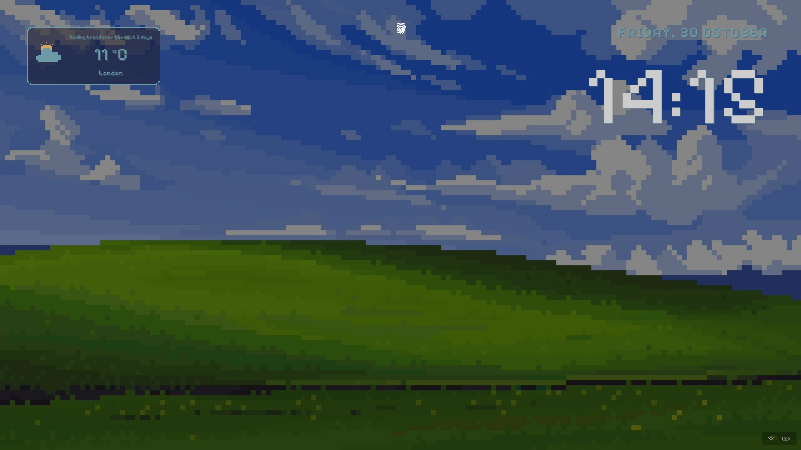
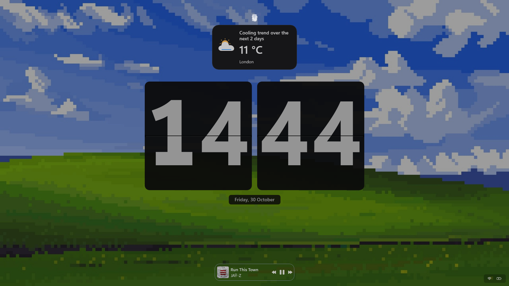
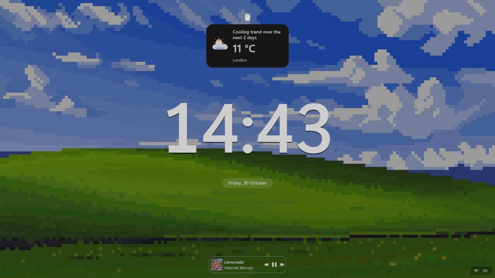

# Lock Screen Studio

Your lock screen, your layout.

I wanted more choice than the standard Windows lock screen, so I made Lock Screen Studio: a set of clock, weather and media themes with the controls to make them your own. Keep it clean, build a desktop-style layout, or go all in on pixel art.

## A little inspiration

### Pixel clock and weather

An upper-right pixel clock and date, paired with a compact weather card on the left. The card uses pixel lettering, angular weather icons and a stepped border.

### Modern Flip

A large split-flap clock in the center, with the date underneath, a dark weather card above and media controls along the bottom.

### Sonoma

A large, clean clock with a separate date pill, a dark weather card and compact media controls.

These are screenshots of my setup. The wallpaper is set separately in Windows and isn't included with the mod. Colors and layout can be changed in Settings.

## Pick your starting point

**Clock themes:** Pixel Coffee, Dusk, Sky, Night, Sakura, Rain, Hollow and Sunset; GNOME Minimal, KDE Breeze, Hyprland Terminal, Nord, Catppuccin Mocha and Gruvbox; LED Matrix, Modern Flip, Vintage Flip, Sonoma, Cyberpunk and Aura. You can also keep the Windows clock.

**Weather/widget and media themes:** Cozy Pixel, Mac Light, Mac Dark, Smoke, Minimal Outline, Nord, Catppuccin and Gruvbox, plus Windows default.

Nord, Catppuccin Mocha and Gruvbox use their published palettes. Mac Light and Mac Dark are inspired by macOS. Each Studio widget theme starts with its own colors, border, opacity and corners. Turn on **Customize widget theme colors and surface** when you want to use your own values.

## Make it yours

- **Clock and date:** choose separate fonts, clock size, 12/24-hour time and seconds. Studio layouts support separate anchors and X/Y offsets for the clock and date, plus date formatting, color and panel controls. The eight Pixel layouts include embedded pixel lettering, so no font installation is needed.
- **Weather and widgets:** use Studio cards for free positioning outside Windows' widget container. Choose an anchor, X/Y offsets, card width, font, text size and screen-edge padding. Customize background, foreground, accent, opacity and corners, or keep the theme defaults.
- **Weather icons:** automatic sun, cloud, rain, storm, snow, sleet, fog, wind and night icons when Windows supplies a recognized condition. Pixel uses angular artwork; other themes use matching colors and finishes. Show or remove the icon, choose a side or corner, and adjust its size and X/Y offsets. A manual condition override is available too.
- **Media:** choose a card theme, font, colors, opacity, corners and text size. Move or hide the media panel while keeping Windows' album art and playback controls.
- **Finishing touches:** add battery and static text elements to Studio layouts, adjust wallpaper dimming, or hide the native widgets. Advanced element rules can change the position, visibility, opacity and supported text properties of named Windows elements.

Colors accept `#RRGGBB` or `#AARRGGBB` (alpha first). Positive X moves right; positive Y moves down. Custom fonts must already be installed and available to the lock screen. Some decorative clock themes keep their own layout and styling.

## Getting started

1. Enable the mod and open its **Settings** tab.
2. Pick a clock theme and a weather/widget theme. Choose **Studio cards** under **Widget rendering mode** for the replacement weather cards and their positioning/icon controls.
3. Keep Weather enabled in Windows' lock-screen settings: Windows still provides the data. Set your wallpaper there too.
4. Lock your PC to see your layout. Start with zero offsets, then adjust the placement to suit your screen.

Selecting **Windows default** for widgets restores the actual Windows card. Studio icon and placement controls apply to the replacement cards. Avoid running another lock-screen clock or styling mod at the same time.

## Compatibility and details

Tested on my Windows 11 26H2 setup with Windhawk 1.7.3, x64. Windows updates may change the lock-screen elements this mod relies on.

Studio cards mirror Windows' available widget text and images; they aren't a separate weather service. Forecast/menu buttons aren't copied. Automatic themed icons depend on readable English condition descriptions; if none are available, the original image is used when possible, otherwise a neutral thermometer appears. Native widget/media discovery can vary by Windows build.

This mod customizes the lock screen, not the password/PIN sign-in screen. Wallpaper selection stays in Windows Settings; animated wallpapers aren't included. Disable the mod to restore the standard appearance.

## Credits and licenses

Lock Screen Studio is maintained by **Mitsu**. It builds on the MIT-licensed Lock Screen Clock Styler engine. The original copyright and permission notice are retained in the source. Pixelify Sans and its embedded outlines retain their SIL Open Font License 1.1 notices. Code: MIT; font data: OFL-1.1.

---

Version **0.0.1** · By **Mitsu** · [Publishing guide](docs/PUBLISHING.md) · [Build notes](docs/DEVELOPMENT.md)
